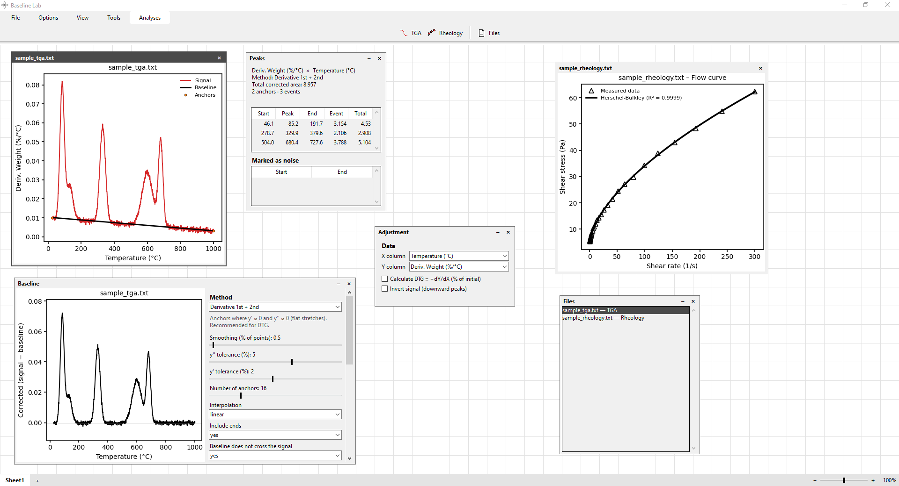
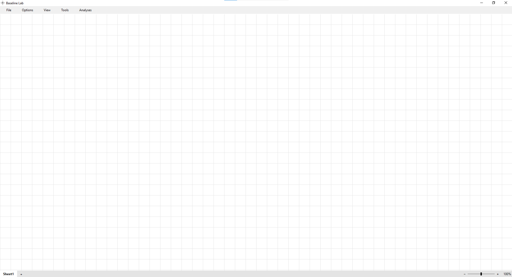

# Baseline Lab

Windows desktop app for lab data analysis, working straight from the `.txt`, `.csv` and
`.xlsx` files exported by the instruments (independent of Origin). It does two analyses:

- **TGA**: plots a signal (typically DTG), fits a baseline to it, finds the peaks and
  calculates their areas.
- **Rheology**: fits a flow curve (shear rate × shear stress) with five models and points out
  the one that best describes the sample.



## Download

Get the latest version from the
[Releases page](https://github.com/valeeeeeeeeeeeeee/Baseline-Lab/releases/latest): unzip it
and run `Baseline Lab.exe`. No installation or Python is needed. Windows SmartScreen may warn
on the first run, since the exe is not signed.

The app checks for new versions when it opens. When there is one, it offers to update now, when
leaving the app, or later ("New update" on the top bar brings the offer back); it downloads the
release, checks it and swaps the app's folder by itself.

## The board

The main window is a blank board. Each file opened becomes a plot in a small window of its own
on it, which is moved by its header and resized by its edges, so plots of different files and
analyses can sit side by side.



- **Analyses** and **Tools**, on the top bar, slide out a second bar with the icons: TGA,
  Rheology and Files under "Analyses"; the tools of the selected plot under "Tools".
- **Selecting a plot**: a click on a plot selects it, and the tools act on the selected plot.
  The tool windows of one analysis hide while a plot of the other one is selected.
- **Sheets**: the tabs at the bottom left ("Sheet1", "+") give each group of plots a board of
  its own. A right click on a tab renames or closes it.
- **Zoom**: the slider at the bottom right, or Ctrl + mouse wheel over the blank of the board,
  zooms the sheet. Over a TGA plot, Ctrl + wheel zooms its axes instead.
- **Files** lists every open plot, of both analyses and all sheets; a click on a row selects it.
- **Notes**: the last icon of "Tools" lets you click anywhere on the board and write a note
  there, with no background, over the grid or the plots.
- **Back / Forward**: the two arrows on the toolbar undo and redo the changes made (files,
  choices, plots' places), a whole drag being one step.
- **Options** switches the language (Portuguese / English) and the theme (light / dark).
  **View > Background format** changes the board's grid.
- **File > Load** opens files for either analysis; **File > Save** saves the selected plot as
  an image. A right click on a plot opens, downloads or copies its image.

## TGA

Open one or more files with the **TGA** icon. A plot shows its signal alone until the baseline
is asked for.

**Adjustment** chooses the X and Y columns of the file and can:

- **Calculate DTG**: when Y is the mass, computes a smoothed −dY/dX divided by the initial
  mass, in % per X unit (like TA's "Deriv. Weight" column).
- **Invert signal**: for events that show as valleys (e.g. DSC with endotherms down), since the
  methods look for upward peaks.

**Baseline** draws the baseline and its anchors on the plot and opens a window with the
corrected plot (signal − baseline) on the left and what the baseline is made with on the right.

| Method | How the anchors are found |
| --- | --- |
| Derivative 1st + 2nd | Where y′ ≈ 0 and y″ ≈ 0 (flat stretches). Recommended for DTG. |
| 2nd derivative (zeros) | Where the curvature y″/(1+y′²)^1.5 ≈ 0, as in Origin. |
| 2nd derivative (peaks) | At the maxima of y″, as in Origin (on broad peaks the anchor may fall on the flank). |
| Iterative polynomial | No anchors: a polynomial is fitted, the points above it (peaks) are lowered, and the fit is repeated. |

The derivative methods take the smoothing, the y′ and y″ tolerances and the number of anchors,
and join the anchors by linear, PCHIP or natural cubic interpolation. They can also keep the
baseline from crossing the signal (new anchors are added where it would pass above it, which
avoids negative areas). **Compare all methods** overlays the baselines of every method.

The anchors are edited with the mouse, on the plot:

- click on the plot: adds an anchor;
- drag an anchor: moves it along the signal;
- right click on an anchor: removes it.

The adjustments are kept for the file, the method and the parameters they were made with.

### Peaks and areas

**Peaks** lists the events found in the corrected signal, with their start, peak and end, the
area of the event and the total area. From the right-click menu of the table a peak can be:

- **Calculate area**: the area of the peak between its ends, under the corrected curve, under
  the signal and under the baseline (in Y unit × X unit).
- **Mark as noise**: takes it out of the results (it can be restored from "Marked as noise").
- **Color** / **Color all**: paints the peak on the plots, with a color picker (wheel, hex
  field, ready-made colors and transparency).

Several peaks can be marked at once with Ctrl + click. The **Calculations** tool keeps a log of
the areas calculated, which can be copied.

## Rheology

Open the files with the **Rheology** icon. X is the shear rate (1/s) and Y the shear stress
(Pa); the columns are chosen in its **Adjustment** window. The curve is fitted with:

| Model | Equation |
| --- | --- |
| Newton | τ = μ·γ̇ |
| Bingham | τ = τ₀ + μp·γ̇ |
| Power law | τ = K·γ̇ⁿ |
| Herschel-Bulkley | τ = τ₀ + K·γ̇ⁿ |
| Casson | √τ = √τ₀ + √(μc·γ̇) |

The models are ranked by AICc (which weighs the fit against the number of parameters), and the
best one is drawn over the data. **Models** shows the table of every fitted model, with its
parameters and R².

## Input files

The reader is tolerant of what the instruments export:

- delimiters: tab, `;`, comma or spaces;
- decimal comma (Brazilian / European convention) or point;
- header and metadata lines before the data;
- UTF-8, UTF-16 and Latin-1 encodings;
- files with more than two columns (X and Y are chosen in the app);
- `.xlsx` spreadsheets (e.g. exported from Origin).

## Running from source

Requires Python (the release is built with 3.13) and the packages in `requirements.txt` (`numpy`, `scipy`, `matplotlib`).

```
pip install -r requirements.txt
python src/main.py            # run the app
python -m pytest -q           # tests (numeric core and translations)
```

The release build is a PyInstaller one-folder build, made by
`.github/workflows/release.yml` when a version tag is pushed.

## Project layout

```
src/main.py                  entry point
src/baseline_lab/
  gui.py           main window, board and TGA analysis
  rheology_gui.py  rheology plot and analysis
  palettes.py      floating tool windows and the color picker
  widgets.py       shared widgets (plot windows, notes, headers)
  baselines.py     baseline methods
  derivative.py    DTG and derivative-based anchors
  peaks.py         peak detection and areas
  rheology.py      flow-curve models and fitting
  io_txt.py        .txt / .csv / .xlsx reader
  updates.py       update check and download
  i18n.py          interface texts (Portuguese and English)
  theme.py         light and dark themes
tests/             pytest
```
